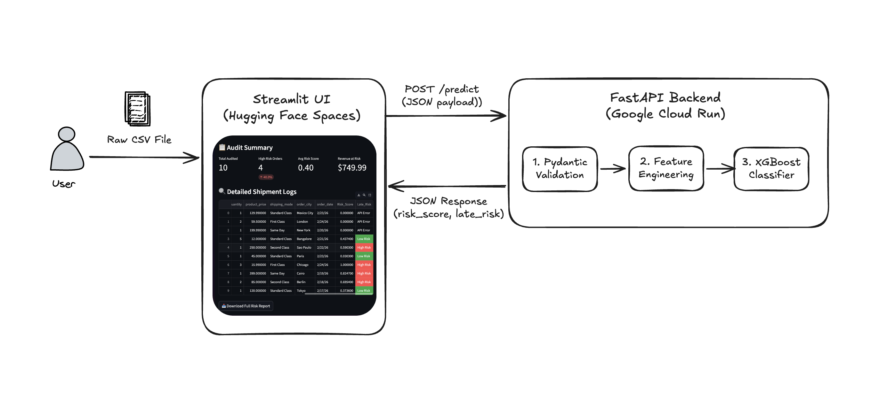

# 🚚 LogiRisk AI: End-to-End Supply Chain Risk Auditor

**Live Demo:** [Go to Hugging Face Space](https://huggingface.co/spaces/kaungsithu-sallius/logistics-risk-auditor)

**API Documentation:** [FastAPI Swagger UI](https://logirisk-api-716133749292.us-central1.run.app/docs)

---

## 🖼️ System Architecture Diagram

> **Note:** The diagram illustrates the decoupled flow between the Streamlit frontend, the FastAPI backend, and the MLflow model management layer.

---

## 🎯 Business Problem
Logistics managers often struggle to identify which shipments are likely to be delayed in a high-volume environment. This project provides a **Decision Support System** that audits raw shipment logs to identify **"Revenue at Risk"** in seconds, allowing for proactive intervention before costs escalate.

---

## 🏗️ System Architecture & MLOps Lifecycle
The system follows a modern, decoupled microservices architecture designed for scalability and reproducibility:

1.  **Frontend (Streamlit):** Hosted on **Hugging Face Spaces**. It serves as the user interaction layer for bulk CSV auditing and real-time visualization.
2.  **Backend (FastAPI):** Dockerized and deployed on **Google Cloud Run**. It manages incoming requests and executes the core logic pipeline.
3.  **Experiment Tracking & Registry (MLflow):**
    * **Tracking:** Logged hyperparameters, evaluation metrics (Accuracy, F1-Score), and training artifacts during the experimentation phase.
    * **Registry:** Centralized model versioning, ensuring the FastAPI production environment always pulls the latest validated and aliased "Production" model.
4.  **Validation (Pydantic):** Ensures strict data integrity and type-safety at the API entry point, rejecting malformed data before it reaches the model.
5.  **Logic (Python):** Executes automated feature engineering on-the-fly (Urgency Scores and Temporal analysis) to prepare raw data for inference.
6.  **Model (XGBoost):** A high-performance tree-based classifier optimized for tabular logistics data, achieving **77% accuracy**.

---

## 🛠️ Tech Stack
* **MLOps:** MLflow (Experiment Tracking, Model Registry).
* **Machine Learning:** Python, Scikit-learn, XGBoost, Pandas.
* **API Framework:** FastAPI, Uvicorn, Pydantic.
* **Frontend:** Streamlit.
* **DevOps/Cloud:** Docker, Google Cloud Run (GCR), Hugging Face Spaces.

---

## 📊 Key Features
* **⚡ Preloaded Example Data:** Allows instant evaluation of the machine learning model and dashboard metrics using sample shipment data without needing to upload a CSV file.
* **Automated Feature Engineering:** Programmatically calculates the `urgency_score` ($days\_scheduled \div quantity$) and extracts temporal insights (`order_month`, `order_day`) from raw date inputs.
* **Bulk Auditing:** Processes shipment manifests with an integrated progress tracker for logistics logs.
* **Executive Dashboard:** Real-time calculation of total **Revenue at Risk**, batch **Average Risk Score**, carrier breakdown charts, and high-risk shipment filtering.
* **Exportable Audit Reports:** One-click download of the audited dataset with appended risk scores and classification badges.

---

## 📋 Required CSV Schema & Column Specifications

If uploading a custom logistics manifest, the CSV file must contain the following **11 columns** (case-insensitive headers):

| Column Name | Type | Description | Example Values |
|---|---|---|---|
| `type` | String | Transaction / Payment method | `TRANSFER`, `DEBIT`, `PAYMENT`, `CASH` |
| `days_for_shipment_scheduled` | Integer | Scheduled delivery SLA (days) | `1`, `2`, `4` |
| `category_id` | Integer | Product catalog category ID | `73` (Sporting), `17` (Cleats), `29` (Apparel) |
| `customer_segment` | String | Purchaser account tier | `Consumer`, `Corporate`, `Home Office` |
| `department_id` | Integer | Warehouse department ID | `2` (Fitness), `4` (Apparel), `6` (Outdoors) |
| `market` | String | Geographic trade destination region | `Pacific Asia`, `USCA`, `Europe`, `LATAM`, `Africa` |
| `order_item_quantity` | Integer | Quantity of units ordered | `1`, `2`, `3`, `4`, `5` |
| `product_price` | Float | Unit price in USD ($) | `327.75`, `59.99`, `129.99`, `199.99` |
| `shipping_mode` | String | Carrier logistics service tier | `Standard Class`, `Second Class`, `First Class`, `Same Day` |
| `order_city` | String | Delivery destination city | `Bekasi`, `Caguas`, `Tokyo`, `Frankfurt`, `Los Angeles` |
| `order_date` | String / Date | Order placement timestamp | `2024-02-15` or `YYYY-MM-DD` |

> 📁 A pre-formatted template is available at [`data/sample_logistics_data.csv`](./data/sample_logistics_data.csv) or can be downloaded directly from the Streamlit UI.

---

## 🚀 How to Run Locally

### 1. Setup Environment

1. Clone the repository.

    ```bash
    git clone https://github.com/KaungSiThu-Sallius/LogiRisk-ML.git
    cd LogiRisk-ML
    ```

2. Install dependencies.

    ```bash
    pip install -r requirements.txt
    ```

3. Start the API backend (optional):

    ```bash
    uvicorn app.main:app --reload
    ```

4. Start the Streamlit Dashboard:

    ```bash
    streamlit run app.py
    ```
